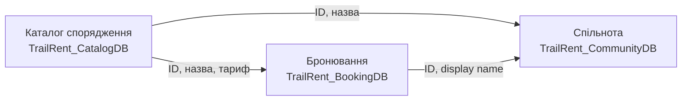
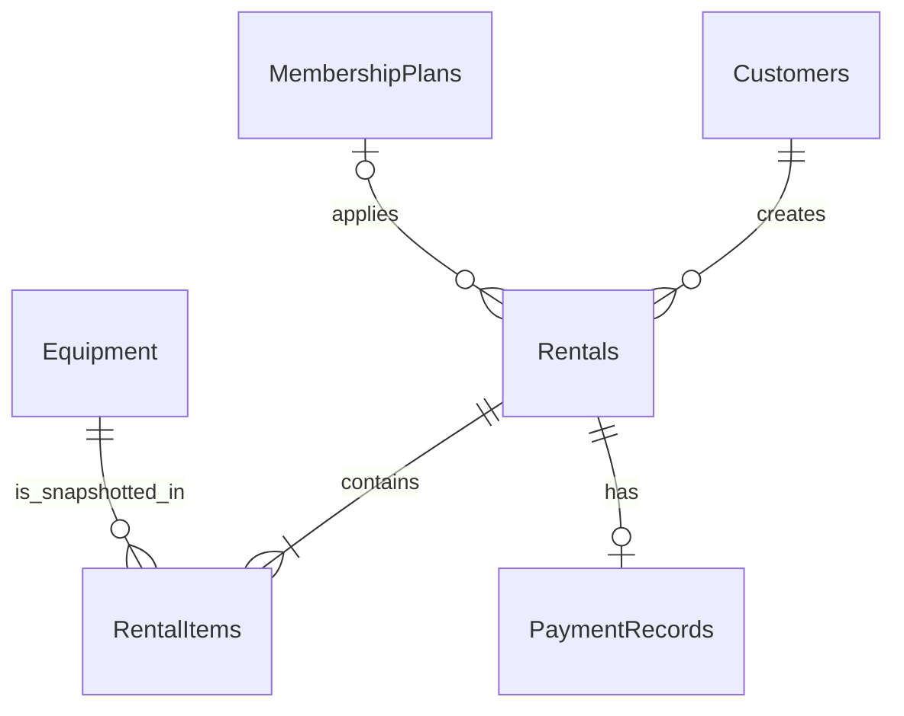
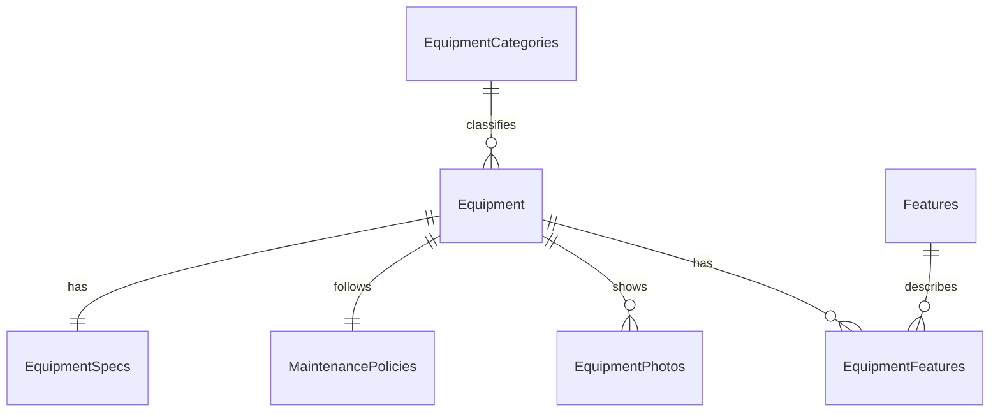

# Архітектура TrailRent

## Межі контекстів

### 1. Бронювання та клієнти — `TrailRent_BookingDB`

Відповідає за профілі клієнтів, бронювання, видані комплекти та платежі.

- `Customers` — контактні дані клієнта.
- `MembershipPlans` — знижка та строк дії абонемента.
- `Equipment` — локальна read-модель доступного спорядження з каталогу.
- `Rentals` — бронювання, дати, статус, сума та `rowversion`.
- `RentalItems` — позиції бронювання; фіксують назву і добовий тариф на час створення.
- `PaymentRecords` — один платіж на одне бронювання.

### 2. Каталог спорядження — `TrailRent_CatalogDB`

Є власником карток спорядження та їхніх характеристик.

- `EquipmentCategories` → `Equipment` — зв'язок 1:N.
- `Equipment` → `EquipmentSpecs` — 1:1 із технічними параметрами.
- `Equipment` → `MaintenancePolicies` — 1:1 із правилами догляду.
- `Equipment` → `EquipmentPhotos` — 1:N.
- `Equipment` ↔ `Features` через `EquipmentFeatures` — M:N, де `AddedAt` є атрибутом зв'язку.

### 3. Відгуки та спільнота — `TrailRent_CommunityDB`

- `equipment_reviews`: автор, оцінка й відповіді зберігаються всередині документа (embedding), бо відгук показується повністю.
- `trip_discussions`: метадані теми, закріплені повідомлення і посилання на спорядження.
- `trail_clubs`: гнучкі профілі туристичних клубів, точки зустрічей і події.

## Політика дублювання даних

| Поле | Де зберігається | Власник | Політика узгодженості |
|---|---|---|---|
| `RentalItems.EquipmentId` | `TrailRent_BookingDB` | `Equipment` у Catalog | Логічне посилання без міжбазового FK. |
| `RentalItems.EquipmentName`, `DailyRate` | Booking | Catalog | Незмінний знімок у момент бронювання. |
| `Equipment.EquipmentName`, `DailyRate` у Booking | Booking | Catalog | Read-модель; синхронізується подіями каталогу. |
| `equipment_reviews.equipmentId`, `equipmentName` | Community | Catalog | ID — логічне посилання, назва — копія для читання. |
| `equipment_reviews.author.userId`, `displayName` | Community | Booking | `userId` — посилання; ім'я — знімок на час публікації. |

У кожного дубльованого поля є єдиний власник. Між базами немає фізичних зовнішніх ключів і немає неконтрольованого dual write.
